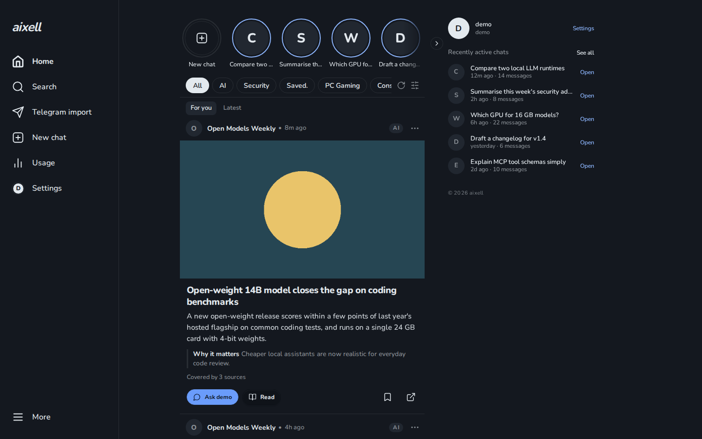
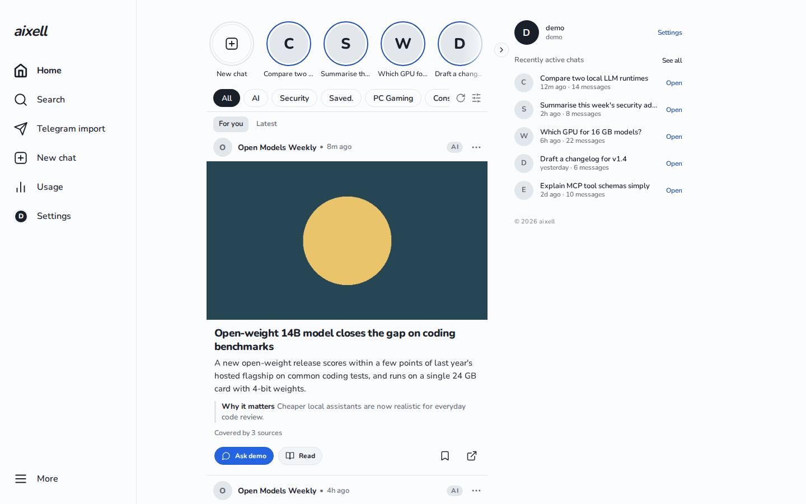
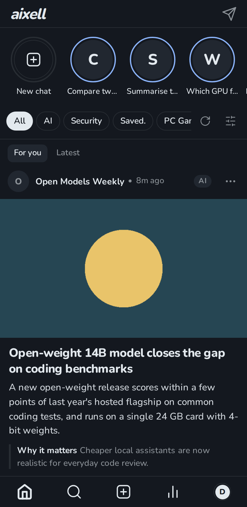
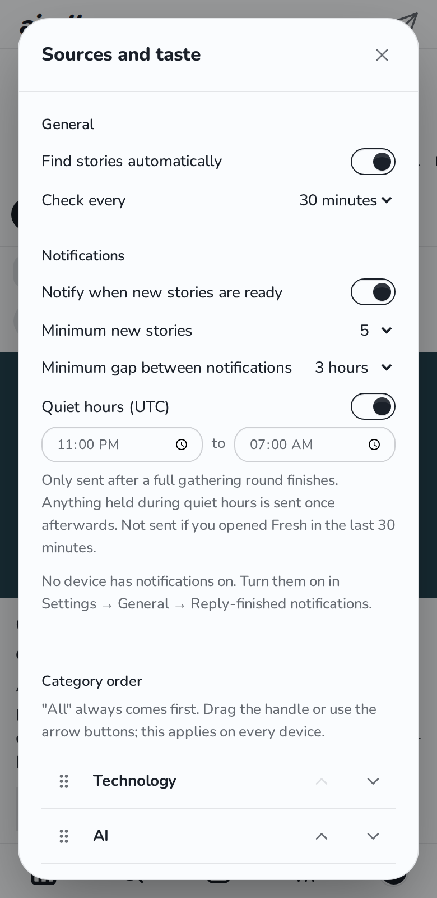
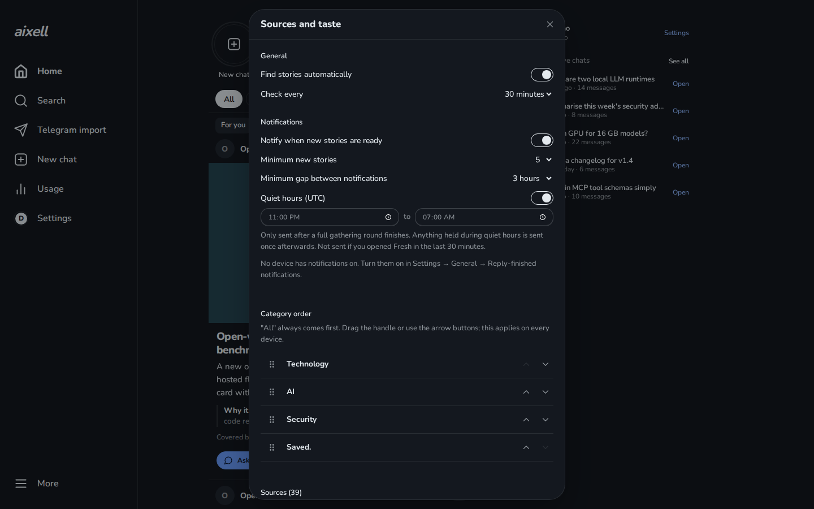

# aixell

A self-hosted, single-user web app with a personal news **Feed**: short, readable story cards collected from sources you
choose, filtered and ranked for one reader, with an optional chat to ask an [Hermes Agent](https://github.com/NousResearch/hermes-agent)
about a story. It is a PWA (installable on a phone), supports web push, and the server is plain Node.js with **no runtime
dependencies** (`node server.js`).

> aixell is an independent, unofficial project. It is not affiliated with, endorsed by, or supported by Nous Research.
> "Hermes" refers to the open-source Hermes Agent that the optional chat talks to.

## Features

- **Feed**: a card timeline built by a background worker. Sources are *connectors* (RSS/Atom, YouTube, GitHub releases and
  advisories, Hacker News, and account-bound ones such as Bluesky, X search, GitHub trends and Steam).
- **Pluggable providers**: the language model that classifies and writes cards is a *provider* you configure
  (any OpenAI-compatible endpoint, or none; with none the app still runs and skips the LLM steps).
- **Pluggable connectors**: add sources in `config.json` or drop in your own module. See [docs/connectors.md](docs/connectors.md).
- **Reader profile**: categories, taste, filter packs and content language are data files, not code.
  See [docs/content.md](docs/content.md).
- **Chat with a Hermes agent** (optional): ask about a story, streaming replies, tool activity, attachments.
- **Login**: password plus TOTP, server-side sessions, CSRF protection, host allow-list.

Screenshots: placeholder, to be added.

## Screenshots

Made-up demo stories, not real articles. Dark and light themes, desktop and phone.

| Feed (desktop, dark) | Feed (desktop, light) |
|---|---|
|  |  |

| Feed (phone) | Sources and taste (phone) | Sources and taste (desktop) |
|---|---|---|
|  |  |  |

## Architecture

```
Browser (PWA)  <->  aixell (Node, one port)  <->  providers (LLM, search)      outbound, SSRF-guarded
                         |                   <->  connectors (feeds, accounts)
                         |                   <->  Hermes API server (optional chat)
                         +-- data/ (login, sessions, feed database, push keys)
```

- `server.js` is the HTTP server: routing, auth, SSE.
- `src/` holds server modules: `config/` (loader, schema, secret refs), `providers/` (contract, registry, adapters),
  `connectors/` (contract, registry, built-in types), `fresh/` (the feed pipeline), `scheduler/`.
- `public/` is the plain ES-module client, served from disk. `ui-build/` builds `public/ui.css` (daisyUI on Tailwind).
- The browser never talks to Hermes or a provider directly.

## Quickstart

Requirements: Linux or macOS, **Node.js 22.5 or newer** (it uses `node:sqlite`; see `.nvmrc`), `git`. Python 3 is only needed for
the optional chat memory and rewind helpers.

```bash
git clone https://github.com/axellageraldinc/aixell.git
cd aixell
npm run set-password            # interactive: prints a TOTP secret and 5 recovery codes; store them safely
cp config.example.json config.json
$EDITOR config.json             # at least server.allowedHosts if you will not use localhost (localhost and 127.0.0.1 are always allowed)
npm start                       # port from config.json (8300 by default); set HERMES_WEB_PORT if that is taken
```

`set-password` creates `data/` if needed and writes `auth-record.json` and `recovery-codes.json` there (or under
`HERMES_WEB_DATA_DIR`). The default username is `admin`; use `--user NAME` for another one. For scripts and containers there is
a non-interactive route that reads the password (12 to 256 bytes) from stdin and prints the same TOTP key and recovery codes:

```bash
printf '%s' "$PASSWORD" | npm run set-password -- --password-stdin --user admin
```

The server does not load `.env` itself: export variables such as `HERMES_WEB_PORT` (overrides the port from `config.json`) in
the shell or in your service manager (`EnvironmentFile=` in systemd). The `node:sqlite` ExperimentalWarning in the log is normal.

Open `http://127.0.0.1:8300/`, log in with the password and an authenticator code, and the Feed opens. With an empty
`connectors` list the shipped presets are used; account-bound ones (Bluesky, X, GitHub trends, Steam) stay unavailable until
configured. Add or change sources as described in [docs/connectors.md](docs/connectors.md) or in the UI source settings.

Headless check (no browser): log in, then trigger a refresh and read the Feed.

```bash
curl -s -c jar -H 'Content-Type: application/json' \
  -d '{"username":"admin","password":"...","code":"123456"}' http://127.0.0.1:8300/api/login     # code = current TOTP, or any one recovery code (each works once)
CSRF=$(curl -s -b jar http://127.0.0.1:8300/api/me | node -pe 'JSON.parse(require("fs").readFileSync(0)).csrf')
curl -s -b jar -X POST -H "X-CSRF-Token: $CSRF" http://127.0.0.1:8300/api/fresh/refresh
curl -s -b jar http://127.0.0.1:8300/api/fresh/
```

Try it with no real services: `node test/fake-hermes/server.js` starts a scripted fake Hermes API (it prints its port),
and `HERMES_WEB_FRESH_OFFLINE=1 npm start` makes the feed use offline stand-ins instead of the internet (mock cards appear a few seconds after `POST /api/fresh/refresh`).

To use a real Hermes agent for chat, see [hermes-profile.example/](hermes-profile.example/README.md) and set `agents` in
`config.json` to your profile name.

## Configuration

Deployment settings live in `config.json` (git-ignored; start from `config.example.json`). A few environment variables
override it; secrets are referenced (`env:NAME`, `file:path#field`), never written inline. Full reference:
[docs/configuration.md](docs/configuration.md). Copy `.env.example` for the variables the code reads.

## Providers

A provider is a configured endpoint that offers one or more *capabilities*: `writer`, `classifier`, `images`,
`socialSearch`, `transcription`, `models`. A capability with no provider is skipped, never an error.

| Type | Use |
|---|---|
| `openai-compatible` | Any OpenAI-style `/chat/completions` endpoint: set `baseUrl` and `apiKey` (a secret ref). |
| `x-api` | Social search through the official X API (bearer token, `allowedHandles`, per-call price). |
| `null` | Explicitly no provider. |

Providers are read from `data/providers.json` (the file is git-ignored with the rest of `data/`); when it is absent, no
capability is available. Further provider types can be added as drop-in files under `data/providers/`. Example `data/providers.json`
(secrets are references, never inline):

```json
{
  "providers": { "main": { "type": "openai-compatible", "baseUrl": "https://llm.example.com/v1", "apiKey": "env:EXAMPLE_API_KEY" } },
  "capabilities": { "writer": { "provider": "main" }, "classifier": { "provider": "main" } }
}
```

## Connectors

Every source is a connector instance in the `connectors` array. Built-in types: `rss`, `youtube`, `github-releases`, `ghsa`,
`hn`, `bluesky`, `x-search`, `github-hype`, `steam`. Account-bound or paid types report `unavailable` until configured and
make no paid or login calls by default. To write your own, see [docs/connectors.md](docs/connectors.md).

## Security model

Single user, self-hosted. Password (scrypt) plus TOTP or recovery code; server-side sessions with `HttpOnly`, `SameSite=Lax`
cookies; CSRF token on every state-changing request; `Host` allow-list and `Origin` check; strict CSP; every outbound fetch goes
through an SSRF guard (public addresses only, redirects re-checked). Secrets live under `data/` or in referenced env vars,
never in the repository. Details and how to report a vulnerability: [SECURITY.md](SECURITY.md).

## Deployment

Run it behind HTTPS. Templates for a `systemd --user` unit, a Cloudflare Tunnel, Caddy and nginx are in
[deploy/examples/](deploy/examples/README.md). Typical steps:

1. Put the repo in a directory and create `config.json` and the login record (`npm run set-password`).
2. Install the `aixell.service` template with your paths, then
   `systemctl --user daemon-reload && systemctl --user enable --now aixell` and `loginctl enable-linger "$USER"`.
3. Put HTTPS in front (tunnel or reverse proxy), list the public hostname in `server.allowedHosts`, and set
   `server.trustCloudflare` only when a local cloudflared connector is the sole way in.
4. Install the PWA from the browser menu and enable notifications in settings.

Back up `data/` and `config.json`; they hold everything that is not code.

## Development

```bash
npm test          # offline unit and integration tests, no credentials
npm run check     # node --check on every source file, then npm test
npm run test:ui   # optional headless-browser smoke test
cd ui-build && npm ci && npm run build   # only when changing styles; public/ui.css is committed
```

See [AGENTS.md](AGENTS.md) for the structure and dependency rules, and [CONTRIBUTING.md](CONTRIBUTING.md) for the workflow.

## FAQ

**Do I need Hermes?** No. The Feed works without it; Hermes is only for the optional chat.

**Do I need an LLM provider?** Not to start. Without one, LLM steps (scoring, writing) are skipped; cards need a writer to be
rewritten, so configure a provider for the full experience.

**Can several people use one instance?** No. It is designed for one reader and one login.

**Does it cost money?** The app does not. Some connectors (for example `x-search`) call paid APIs and are capped by
`dailyCap`; they stay off until you configure them.

**Which license?** AGPL-3.0-only. See [LICENSE](LICENSE) and [docs/license-policy.md](docs/license-policy.md). Third-party
components: [THIRD_PARTY_NOTICES.md](THIRD_PARTY_NOTICES.md).

Copyright (C) 2026 Axell. Licensed under the GNU Affero General Public License v3.0 only.
